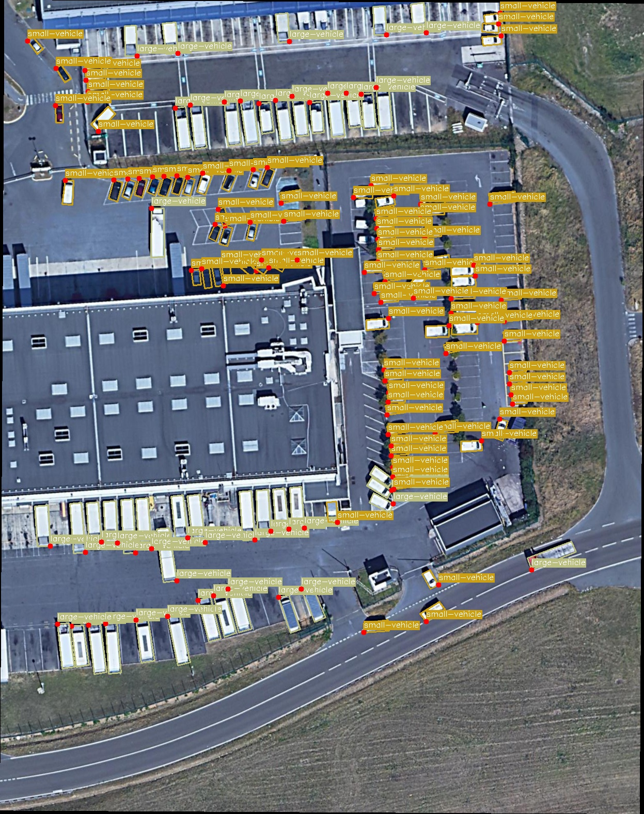
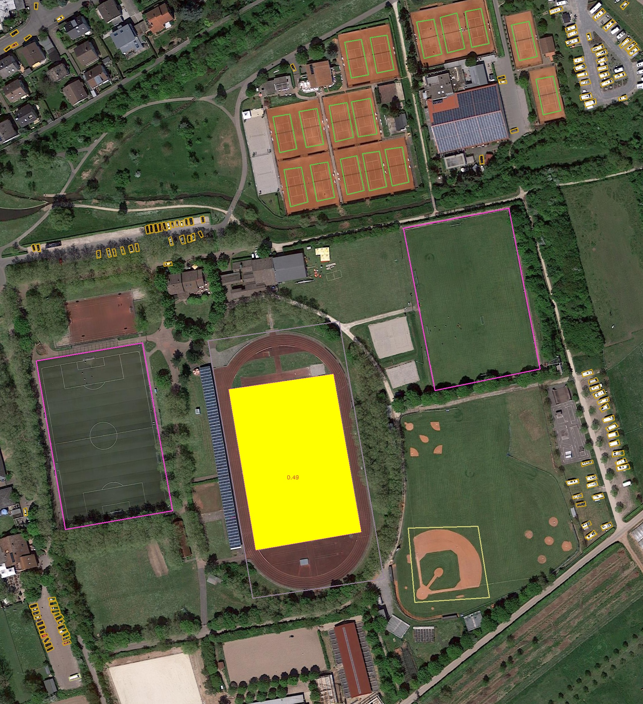

# 目标检测 OBB 标签预处理工具

[](https://github.com/vyu-yu/object-detection-preprocessing/actions/workflows/ci.yml)

一个面向遥感图像目标检测的桌面预处理工具，支持 DOTA 风格旋转框标签的解析、往返保存、IoU 计算、重叠检测、负样本生成和结果可视化。项目提供 Tkinter 图形界面和无界面命令行两种使用方式。



## 项目亮点

- **标签可靠往返**：兼容旧版逗号格式，统一输出标准空格分隔标签，不会在保存后破坏标签结构。
- **旋转框几何计算**：基于 Shapely 计算任意旋转框面积、交集和 IoU，支持批量 IoU 矩阵及重叠框过滤。
- **坐标转换**：支持像素坐标与归一化坐标互相转换，并保留类别、难度和图像 ID 信息。
- **可复现负样本**：通过随机种子生成与真实目标低重叠的负样本，并导出独立 JSON 清单。
- **完整可视化流程**：输出旋转框、指定框对 IoU 交叠区域以及重叠框热区。
- **图形界面**：提供图像缩放、放大镜、IoU 表格、CSV 导出和标签另存功能。
- **自动化验证**：使用 pytest 覆盖标签、几何计算、随机采样和 CLI 端到端流程，并由 GitHub Actions 持续检查。

## 预览

| 标签可视化 | 重叠区域分析 |
| --- | --- |
|  |  |

## 技术栈

- Python 3.10+
- Tkinter / Pillow
- OpenCV
- Shapely
- NumPy
- pytest / GitHub Actions

## 快速开始

### 1. 获取项目

```powershell
git clone https://github.com/vyu-yu/object-detection-preprocessing.git
cd object-detection-preprocessing
```

### 2. 创建虚拟环境

Windows PowerShell：

```powershell
python -m venv .venv
.\.venv\Scripts\Activate.ps1
python -m pip install --upgrade pip
python -m pip install -r requirements.txt
```

macOS / Linux：

```bash
python3 -m venv .venv
source .venv/bin/activate
python -m pip install --upgrade pip
python -m pip install -r requirements.txt
```

Linux 如果缺少 Tkinter，需要先安装系统包，例如 Ubuntu：

```bash
sudo apt-get install python3-tk
```

### 3. 启动图形界面

Windows 用户也可以直接双击 `run_gui.bat` 启动；首次运行会自动创建 `.venv` 并安装依赖。

```powershell
python gui.py
```

操作顺序：

1. 选择图像文件和对应标签文件。
2. 点击“解析标签”查看旋转框。
3. 使用“可视化”“计算所有IoU”“检测重叠”“生成负样本”等按钮。
4. 点击“保存标签结果”导出处理后的标签。

## 命令行用法

使用仓库内置样例运行完整流程：

```powershell
python main.py `
  --image data/images/P2629.png `
  --label data/labels/P2629.txt `
  --output outputs `
  --visualize `
  --visualize-overlaps `
  --generate-negatives `
  --num-negatives 3 `
  --seed 42
```

查看全部参数：

```powershell
python main.py --help
```

关键参数：

| 参数 | 说明 |
| --- | --- |
| `--image` | 输入图像路径，必填 |
| `--label` | 输入 DOTA 风格标签路径，必填 |
| `--output` | 输出根目录，默认 `outputs/` |
| `--visualize` | 保存旋转框和首个框对 IoU 的可视化 |
| `--visualize-overlaps` | 保存重叠区域可视化 |
| `--iou-threshold` | 重叠检测阈值，默认 `0.5` |
| `--generate-negatives` | 生成低 IoU 负样本 |
| `--num-negatives` | 目标负样本数量，默认 `3` |
| `--seed` | 负样本随机种子，默认 `42` |

示例输出：

```text
outputs/
├── P2629.txt
├── negative_boxes/
│   └── P2629.json
└── visualizations/
    ├── original_boxes.jpg
    ├── P2629_iou_0.000.jpg
    ├── overlaps.jpg
    └── with_negatives.jpg
```

负样本使用 `class_id=-1`，不与真实目标标签混写，因此单独保存为 JSON。每条记录包含 8 个绝对像素坐标：

```json
{
  "seed": 42,
  "max_iou": 0.3,
  "boxes": [
    [12.4, 25.8, 72.4, 25.8, 72.4, 95.8, 12.4, 95.8]
  ]
}
```

## 标签格式

输入和输出采用 DOTA 风格的文本格式：

```text
imagesource:GoogleEarth
gsd:0.121644374484
x1 y1 x2 y2 x3 y3 x4 y4 class-name difficult
```

示例：

```text
970 69 971 85 935 88 933 71 small-vehicle 0
428 507 444 506 449 546 434 549 small-vehicle 1
```

- 坐标顺序为左上、右上、右下、左下，也支持其他有意义的四点多边形顺序。
- 类别名称来自 `config.py` 中的 `CLASS_MAP`。
- `difficult=1` 表示难以检测的目标。
- 旧版逗号分隔文件可以读取，新文件统一使用空格分隔。
- 元数据支持 `acquisition dates`、`imagesource` 和 `gsd`。

## 项目结构

```text
.
├── config.py                    # 路径、类别映射和常量
├── main.py                      # 命令行入口
├── gui.py                       # Tkinter 图形界面
├── run_gui.bat                  # Windows 一键启动脚本
├── core/
│   ├── converter.py             # 坐标转换
│   ├── iou_calculator.py        # IoU 和 IoU 矩阵
│   ├── negative_sampler.py      # 可复现负样本采样
│   ├── obb.py                   # 旋转框数据模型
│   ├── overlap_detector.py      # 重叠检测与过滤
│   ├── parser.py                # 标签解析和保存
│   └── visualizer.py            # OpenCV 可视化
├── data/
│   ├── images/                  # 两张 DOTA 样例图
│   └── labels/                  # 对应标签
├── docs/                        # README 展示图
├── tests/                       # pytest 测试
└── .github/workflows/ci.yml     # GitHub Actions
```

## 测试

安装开发依赖：

```powershell
python -m pip install -r requirements-dev.txt
```

运行测试：

```powershell
python -m pytest
```

测试覆盖：

- 标签保存后重新解析、旧格式兼容和未知类别报错
- 归一化/绝对坐标转换
- 旋转框 IoU、重叠检测和过滤
- 负样本边界与随机种子复现
- CLI 输出目录、可视化、负样本 JSON 和标签导出

## 运行与部署说明

这是一个本地 Python/Tkinter 桌面应用，GitHub 用于源码托管和作品集展示。GitHub Pages 不能直接运行 Tkinter、OpenCV 桌面程序，因此在线仓库不会提供可点击的交互页面；要使用完整功能，请按“快速开始”在本地运行。

如果后续需要浏览器在线演示，可以保留当前 `core/` 计算层，新增 Streamlit 或 FastAPI + Web 前端，将预处理结果作为网页交互界面展示。

## 数据集说明

`data/` 中仅保留两张 DOTA 样例图像和对应标签用于功能演示。样例影像版权归原数据集及原始影像提供方所有，使用时应遵守 DOTA 数据集和相关影像来源的许可条款。

## License

项目源代码使用 [MIT License](LICENSE)。DOTA 样例图像不包含在 MIT 源代码许可范围内。
